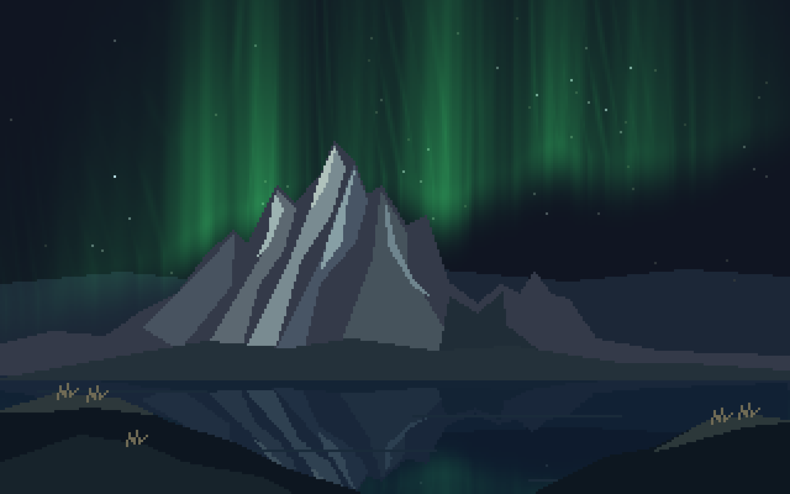
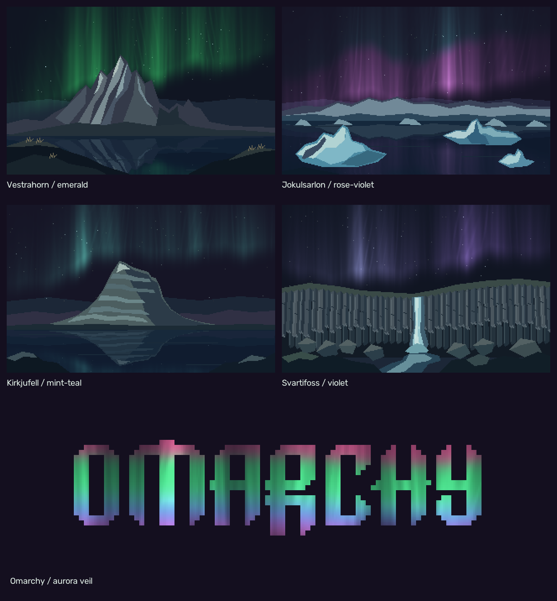

# Borealis

A dark Omarchy theme with four Icelandic landmark backgrounds and an animated
Omarchy wordmark. Violet surfaces, teal accents and warm pale text are shared
across supported applications.

The art is drawn directly on a 320 × 200 grid. Terrain uses flat colour
clusters; aurora light fades across the same logical pixels and inside the
sharply clipped wordmark.
Videos are enlarged exactly 8× with nearest-neighbour scaling:
2560 × 1600, 24 fps, silent, 40-second loops. No source photograph pixels,
image-space blur filters, antialiasing or camera motion are used.



## Five backgrounds

| File | Identifying features |
| --- | --- |
| `01-vestrahorn.mp4` | Jagged horns above wet black sand, dunes and grass tufts; an emerald veil with luminous long rays |
| `02-jokulsarlon.mp4` | Blue faceted icebergs, a dark ash seam and a low glacial horizon; rose-violet light blending into faint cool teal |
| `03-kirkjufell.mp4` | A broad, sloping roof, spreading foot and subdued horizontal strata; a quieter distant mint-teal veil |
| `04-svartifoss.mp4` | A narrow white fall framed by hanging basalt prisms, recessed columns and broken scree; violet light with restrained emerald |
| `05-omarchy.mp4` | A translucent pleated veil inside the letters, with horizontally flowing red, green/mint, teal/blue and violet/pink light |

These are stylized interpretations of the landmarks, with independently arranged
night scenes. The fifth background uses the original Omarchy wordmark geometry.



The lead image and stills use selected frames from the animations, with the
same lighting and palette. Frame times are recorded in [reports/stills.json](reports/stills.json).

## Readability

The palette keeps deep violet surfaces, teal accents and pale text. Muted text,
red, magenta and brown were lifted for readable comments and syntax. Normal
text targets at least 4.5:1 contrast; focus indicators target 3:1, using the
[WCAG contrast method](https://www.w3.org/WAI/WCAG22/Understanding/contrast-minimum.html).
The measured main-text ratio is 15.55:1. Muted text is 6.64:1 on the main
background and 5.25:1 on raised violet surfaces.

Borealis separates muted text from tag, button and completion-menu fills.
Focused controls have explicit teal outlines, and the lock input uses an opaque
card. The audit covers stock opaque surfaces, generated VS Code/terminal
roles and resolved Aether v3 highlights. Arbitrary ANSI combinations, user
opacity overrides and third-party app styling are outside that audit.
See [the measured role pairs](reports/readability.json).

## Stars and one meteor

Cassiopeia appears over Vestrahorn and Kirkjufell, the Big Dipper over the lagoon,
and the Little Dipper (including Polaris) over Svartifoss. Star positions and
magnitudes come from the [Bright Star Catalogue 5 at NOIRLab/KPNO](https://www-kpno.kpno.noirlab.edu/Info/Caches/Catalogs/BSC5/catalog5.html).
Their relative geometry is projected from J2000 coordinates. Each artwork has
its own framing and camera roll; this is not a dated geographic sky simulation.
No constellation lines or labels are drawn in the wallpapers.

Each landscape has one short, one-pixel-wide meteor per 40-second loop. Its
fading event lasts about 0.75 seconds, starting at 18 s (Vestrahorn), 24 s
(Jökulsárlón), 14 s (Kirkjufell) or 30 s (Svartifoss). The Omarchy wordmark
background remains plain. The guide data and event validation live in
[reports/sky-map.json](reports/sky-map.json).

## Install from GitHub

```bash
omarchy theme install https://github.com/thijs5/omarchy-borealis-theme
```

Omarchy regenerates Neovim's configuration for themes installed from Git.
The additional Aether contrast callback in this repository is retained by the
manual-copy installation below; it is not applied by the Git installer.

## Install locally

Copy this directory to `~/.config/omarchy/themes/borealis`, then select:

```bash
omarchy theme set borealis
```

Omarchy generates application configurations from `colors.toml`. The theme
covers terminals, editors, shell, launcher, notifications, lock screen and
other supported apps. Icons use `Yaru-prussiangreen-dark` when available.

Cycle the backgrounds:

```bash
omarchy theme bg next
```

Choose the wordmark directly:

```bash
omarchy theme bg set ~/.config/omarchy/themes/borealis/backgrounds/05-omarchy.mp4
```

Video playback requires Omarchy's video-wallpaper support. Omarchy manages
playback and its normal power and visibility policies; no theme hooks, launch
scripts or additional wallpaper processes are installed.

Lossless stills live in `previews/`, outside the normal five-video rotation.
They can also be used on older Omarchy installations:

```bash
omarchy theme bg set ~/.config/omarchy/themes/borealis/previews/01-vestrahorn.png
```

The 16:10 artwork fits a 2560 × 1600 display exactly. Other aspect ratios can
crop the composition. Integer scaling preserves the logical pixel grid most
faithfully; fractional scaling on other resolutions can change pixel sizes.

## Animation and visual review

The auroras use tall hanging veils with long, nearly vertical rays. Broad
pleats sway slowly and their hems fade gradually into the sky. Internal
contrast and narrow highlights are subdued. Rose-violet and teal emission share
the same strands over the lagoon and blend additively where they overlap.

The landscape videos use stronger emitted light throughout their full loops,
with brighter folds and reflections against the dark sky. Their light output
is lifted by 55–65% from the earlier restrained version. The logo's veil also
has a modest luminosity lift, preserving its dark gaps and colour transitions.
Movement speed, veil geometry, star positions and the UI palette are unchanged.

Aurora light is evaluated continuously on the 320 × 200 grid and added to the
night sky. Hard palette thresholds, abrupt visibility masks and color-winner
boundaries have been removed. The terrain retains its fixed colour clusters, and the wordmark retains its
sharp mask. Every output pixel remains an exact integer enlargement of
the logical grid; no image-space blur or antialiasing filter is applied.

Each landscape has a distinct light balance: emerald and pale mint at
Vestrahorn, rose-violet and cool teal at Jökulsárlón, mint-teal at Kirkjufell,
and violet with restrained emerald at Svartifoss. The accepted veil geometry,
timing, landscape colours, star fields and UI palette stay consistent. These
are artistic colour treatments, not spectral simulations.

The wordmark uses the same long, pleated light-field model as the landscapes.
Fine hanging strands, dark gaps and pale concentrations move through softly
overlapping horizontal colour regions. No flat colour stripes or hard band
boundaries remain. Every pixel outside its letters, including the counters, remains
`#140F1F`.

Its top-to-bottom colour order follows a typical multicolour aurora: high red,
a broad green region with mint/teal transitions, overlapping blue, then a
violet/pink lower fringe. The gas emissions overlap in nature, so this is an
artistic altitude arrangement rather than a strict rainbow spectrum. See
[NASA's aurora colour explanation](https://science.nasa.gov/sun/auroras/).

See [DESIGN-REVIEW.md](DESIGN-REVIEW.md) for the critique, corrections and remaining
limitations, and [REFERENCES.md](REFERENCES.md) for landmark and aurora sources.

## Regenerate UI overrides

On an Omarchy installation, rebuild the scoped app overrides from the installed
templates and audit them with:

```bash
python tools/build_ui.py
python tools/audit_colors.py
```

The audit also loads the installed Aether v3 theme in an isolated headless
Neovim session. Use `--aether-dir` if that plugin has a different location.
The Neovim contrast callback is retained by the manual-copy installation above.
Omarchy's Git installer regenerates `neovim.lua`, so that installation route
would need the same Aether fixes in its generated template.

## Regenerate

Python 3, NumPy, OpenCV and FFmpeg with libx264 are only rendering dependencies.

```bash
python -m venv /tmp/borealis-render
/tmp/borealis-render/bin/pip install -r tools/requirements.txt
/tmp/borealis-render/bin/python tools/render.py
```

Use `--posters-only` for the selected stills or `--scene 4` for one background (1–5).
Regenerate all five stills, the repository lead image and the contact sheet with:

```bash
python tools/render_previews.py
```

`tools/aurora.py` defines the moving light veils and additive emission;
`tools/render.py` draws the landmarks, reflections and wordmark, then encodes
the videos. Both files are needed to regenerate the backgrounds.
The included mask follows the wordmark's original 81 × 19 block grid.
Rebuild it from the included SVG with:

```bash
rsvg-convert -w 81 -h 19 assets/omarchy.svg -o assets/omarchy-mask.png
```

## Credits and license

Original landmark drawings, animation and theme assembly: Thijs Dickmans, 2026.
MIT License; see `LICENSE`.

The palette is adapted from [Aurora by thevideinfra](https://github.com/thevideinfra/omarchy-aurora-theme),
copyright 2026 Kyle. Its MIT notice is preserved in `LICENSES/aurora.txt`.

The [Omarchy wordmark](https://github.com/basecamp/omarchy/blob/master/logo.svg)
is copyright David Heinemeier Hansson. Its MIT notice is preserved in
`LICENSES/omarchy.txt`. This is an independent community theme.
No third-party photographs or video footage are bundled.
